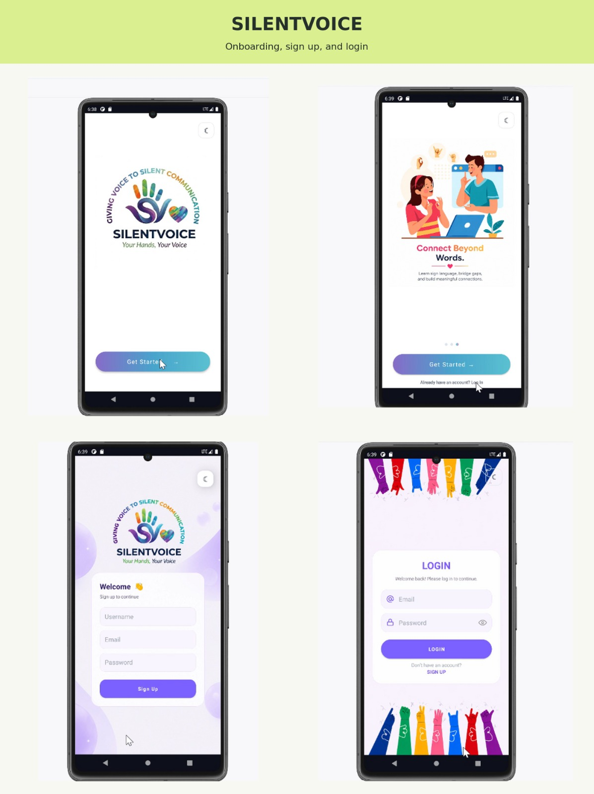
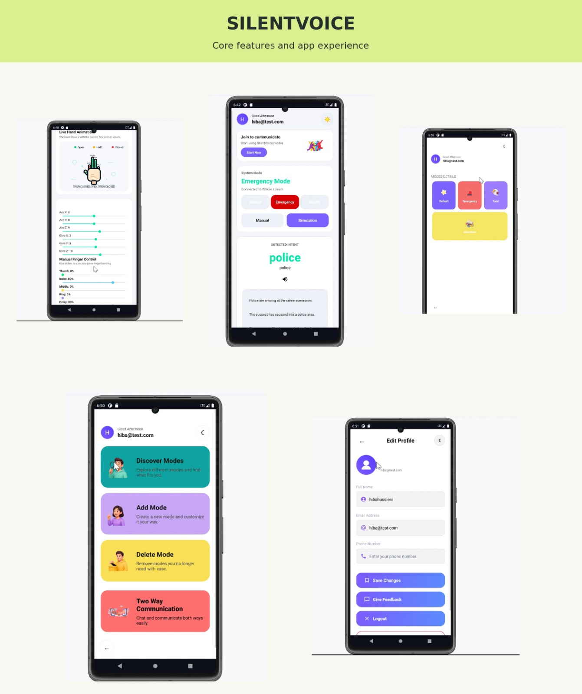

# SilentVoice

An Android application and Spring Boot backend developed as a Computer and Communication Engineering graduation project at the Lebanese International University.

SilentVoice explores assistive communication through predefined hand-gesture mappings, sensor data, and AI-assisted sentence generation.

## App Preview

### Onboarding, Sign Up, and Login



### Core Features



These screenshots show the original project demonstration. End-to-end operation has not been reverified for this portfolio copy.

## Features

- Android interfaces built with Java and XML.
- User registration, login, and profile management.
- Communication modes with configurable gesture mappings.
- REST API integration using Retrofit and JSON.
- Sensor-data processing and gesture matching.
- Translation history and user feedback.
- AI-assisted sentence generation through a local Ollama service.
- SOS-related functionality requiring device permissions and a compatible setup.

## Technology Stack

| Component | Technologies |
| --- | --- |
| Android application | Java, XML, Android SDK |
| API client | Retrofit, Gson, JSON |
| Backend | Java 17, Spring Boot, Spring Data JPA |
| Database | MySQL-compatible database |
| AI integration | Ollama, Llama 3.1 |
| Build tools | Gradle Wrapper, Maven Wrapper |

## Repository Contents

- `android-app/`: Android application source and Gradle configuration.
- `backend/`: Spring Boot REST API and Maven configuration.
- `database/silent_voice_schema.sql`: database tables, indexes, and relationships without user records.
- `docs/`: screenshots from the original project demonstration.

## Requirements

- JDK 17 for the backend.
- Android Studio and the Android SDK required by the Gradle configuration.
- Android emulator or compatible Android device.
- A running MySQL-compatible database.
- Internet access to download build dependencies.
- Ollama with the configured model for AI-assisted features.
- A compatible sensor-data service for live sensor functionality.

## Database Setup

1. Create a new, empty database named `silent_voice_db`.
2. Import `database/silent_voice_schema.sql` into that database.
3. Configure the backend connection using the environment variables below.

The SQL file contains schema only. It does not include accounts, passwords, translation history, or other user records.

Use a separate database for this project. The backend uses Hibernate's `update` setting, which can modify its configured database schema.

## Backend Configuration

The backend reads its settings from environment variables:

| Variable | Purpose | Default |
| --- | --- | --- |
| `DB_USERNAME` | Database username | Required |
| `DB_PASSWORD` | Database password | Required |
| `DB_URL` | JDBC database connection URL | Local database on port 3307 |
| `SERVER_PORT` | Backend HTTP port | `8081` |
| `OLLAMA_BASE_URL` | Ollama server URL | `http://localhost:11434` |
| `OLLAMA_MODEL` | Ollama model name | `llama3.1` |

Database credentials must be supplied locally rather than committed to Git.

### Run the Backend on Windows

From the repository root, open PowerShell and configure your own database credentials:

```powershell
$env:DB_USERNAME = "your_database_username"
$env:DB_PASSWORD = "your_database_password"
$env:DB_URL = "jdbc:mysql://localhost:3307/silent_voice_db?useSSL=false&serverTimezone=UTC&allowPublicKeyRetrieval=true"

.\backend\mvnw.cmd -f .\backend\pom.xml spring-boot:run
```

Replace the example credentials and adjust the database port if necessary.

These environment variables apply to the current PowerShell session. A `.env` file is not loaded automatically by this configuration.

### Compile the Backend

```powershell
.\backend\mvnw.cmd -f .\backend\pom.xml -DskipTests compile
```

Compilation does not require a running database and does not execute tests.

## Android Setup

1. Open `android-app/` as a project in Android Studio.
2. Install the requested SDK components and allow Gradle to sync.
3. Start the backend and required supporting services.
4. Select an Android emulator and run the application.

The current Android configuration uses these local development addresses:

| Address | Purpose |
| --- | --- |
| `http://10.0.2.2:8081/` | Spring Boot backend |
| `http://10.0.2.2:8180/data` | Sensor-data service |

On the standard Android Emulator, `10.0.2.2` refers to the host computer.

For a physical Android device, update the relevant URLs to the computer's reachable LAN address. The device and computer must have network connectivity, and the required ports must be accessible.

The sensor-data service on port `8180` is a separate requirement. Starting the Spring Boot backend on port `8081` does not start that service.

## Ollama Setup

For AI-assisted features, start Ollama and download the configured model:

```shell
ollama pull llama3.1
```

The default backend configuration expects Ollama at `http://localhost:11434`.

## Verification Status

- Backend compilation succeeded locally on October 29, 2026.
- Lombok builder-default warnings in `User` and `Mode` were corrected, and compilation succeeded again without those warnings.
- Automated tests were not executed during this preparation.
- Android build and end-to-end operation have not been reverified for this portfolio copy.

## Current Limitations

- Gesture recognition depends on predefined mappings and compatible sensor input; it is not a general-purpose sign-language translator.
- Local service addresses require configuration for different environments.
- Live sensor features require an independently configured sensor-data service.
- AI-assisted features require Ollama and the configured model.
- The current backend security configuration permits all HTTP requests; endpoint authorization needs further work before public deployment.
- SOS functionality is an academic prototype and has not been validated as a reliable emergency service.

## Project Context

Prepared for portfolio review by Hiba Hussieni.

This repository presents the Android application, backend, and database schema from the SilentVoice graduation project.